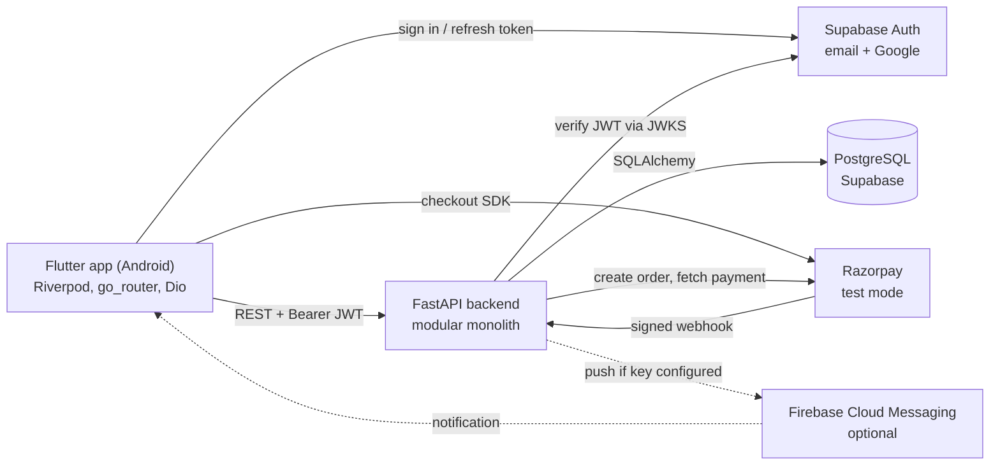
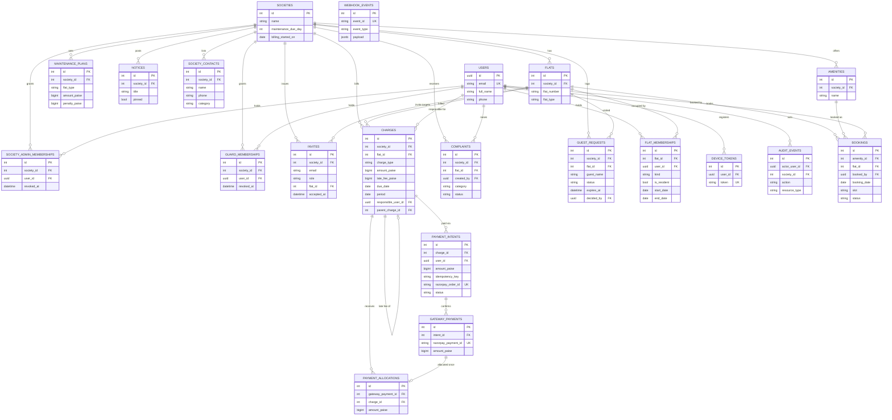
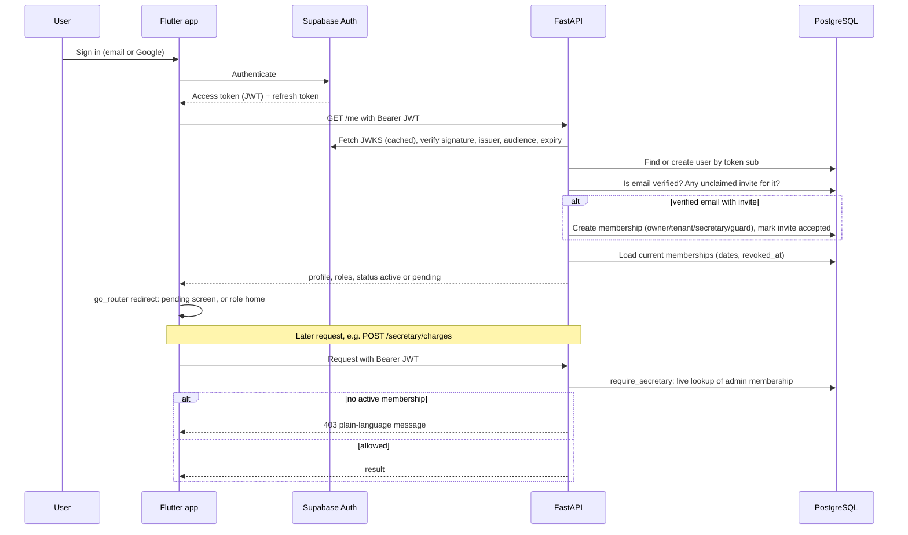
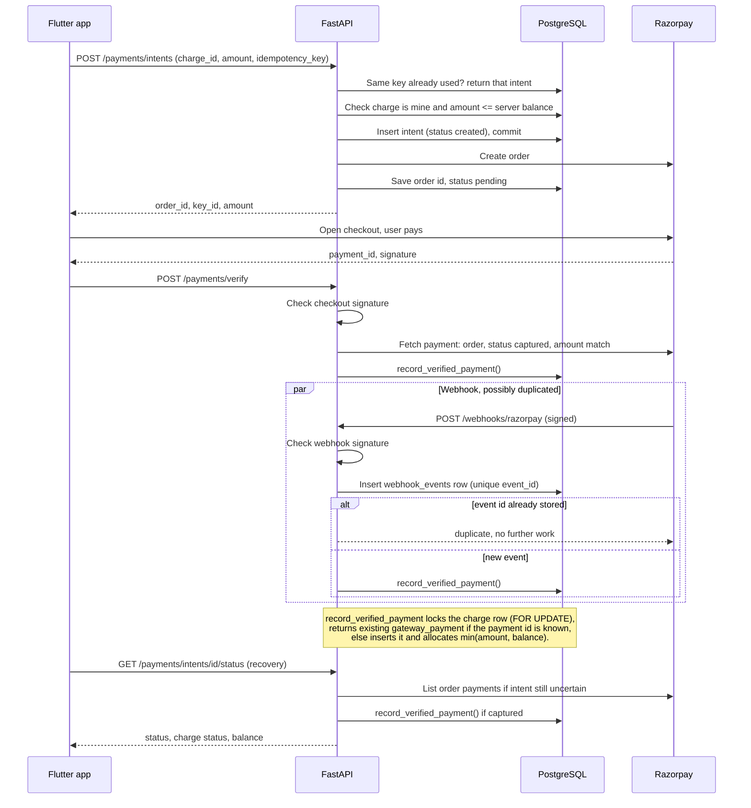
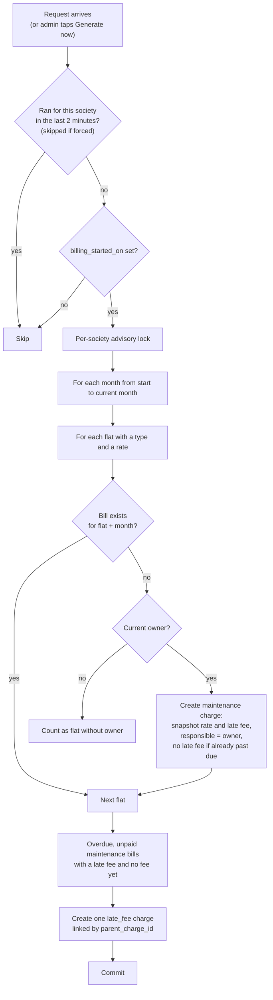

# SocietyOS Architecture

## 1. System overview



The app never talks to the database directly. It authenticates with Supabase, then calls the backend with the Supabase access token. The backend verifies the token, applies authorization, and owns all business rules.

## 2. Data model

Identity is separate from roles. `users.id` equals the Supabase auth user id. Roles are dated or revocable memberships.



`webhook_events` has no foreign keys; it stores raw deliveries keyed by the gateway event id.

Database constraints that carry business rules:

| Constraint | Rule it enforces |
|---|---|
| `uq_charge_maintenance_period` (partial unique) | One maintenance bill per flat per month |
| `uq_charge_late_fee_parent` (partial unique) | At most one late fee per bill |
| `uq_intents_user_idem` | Same client attempt gives the same payment intent |
| `gateway_payments.razorpay_payment_id` unique | A gateway payment is recorded once |
| `payment_allocations.gateway_payment_id` unique | A payment is allocated once |
| `webhook_events.event_id` unique | A webhook delivery is processed once |
| `uq_booking_slot_confirmed` (partial unique) | No double booking of a hall slot |
| `uq_admin_active`, `uq_guard_active` (partial unique) | One active admin or guard grant per person per society |
| `ck_*_amount_positive`, status and kind checks | No zero or negative money, no invalid states |

## 3. Sign-in and authorization



Key points:
- A valid token only proves identity. With no membership the user is `pending` and sees a waiting screen.
- An invite is claimed only when the email is verified, so nobody can take an owner's invite by signing up first with that address.
- Membership is read from the database on each request, so revoking access works immediately and does not wait for token expiry.
- When a request returns 401, the Dio interceptor refreshes the Supabase session once and retries.

## 4. Payment flow (PayEngine)



Notes:
- The balance of a bill is never stored. It is the charge amount minus the sum of its allocations.
- Partial payments are normal: a bill is `outstanding`, `partial` or `paid` depending on the allocated total.
- Three paths can confirm a payment (client verify, webhook, status reconciliation). All call the same function and converge on one `gateway_payments` row through a unique constraint.
- The intent is committed before the gateway call, so a crash never leaves an unexplained gateway order.
- If the app is killed after paying, the status endpoint reconciles against Razorpay.

## 5. Monthly billing



Society-wide festival or repair charges use `POST /secretary/charges` without a flat id. The server creates one charge per flat, billing the owner or the tenant (falling back to the owner when a flat has no tenant), and reports skipped flats that have nobody to bill.

## 6. Key design decisions

| Decision | Reason |
|---|---|
| Modular monolith: one FastAPI app, one router module per area, shared services for billing and payments | A small team and a single deploy. Module boundaries keep it easy to read and to split later; microservices would add cost with no benefit at this size. |
| Memberships, not a role column | A person can be an owner of one flat, a tenant of another, and the secretary. Dated memberships also preserve history and let moving out end a role without deleting anything. |
| Live membership check on every request | Revocation is immediate. The cost is one query per request, accepted for correctness. |
| Invite-based onboarding with verified email | Google or email sign-in proves identity only. Access comes from the admin registering the email. |
| All money in integer paise | No floating-point rounding. Amounts are `BIGINT` with positive-amount checks. |
| Snapshots on charges (responsible user, rate, late fee) | Later move-outs or rate edits must not rewrite past bills. |
| Derived balances from append-only allocations | No stored balance to drift out of sync. Payments and allocations are never edited. |
| Idempotency plus database constraints | Retries, duplicate webhooks and races are normal in payments. Unique indexes make correctness hold even if application code has a bug or two requests collide. |
| Server is the source of truth for amounts | The client sends an amount, the server checks it against the balance and confirms with Razorpay; client status claims are not trusted. |
| Lazy billing instead of a scheduler | No free always-on job runner. The engine is idempotent (unique indexes, advisory lock), so running it from requests is safe. Throttled to once per 2 minutes per society, except when the admin changes rates or taps Generate. Documented shortcut; replace with a scheduled job. |
| Polling instead of push | FCM needs Firebase files and device setup. The database is the source of truth and the app polls (the guest approval and guard screens refresh every 8 seconds). Push is optional and fails silently, so it never breaks a request. |
| Conditional UPDATE for guest decisions | `UPDATE ... WHERE status='pending' AND not expired` means the first valid answer wins atomically when two residents respond. |
| Partial unique index for hall bookings | The database, not application code, prevents double booking under concurrent requests. |
| 404 instead of 403 for others' records | Does not reveal that a bill or visitor request exists. |
| Audit events | Admin actions, invite claims and payments are recorded in `audit_events`. |

## 7. Flutter structure

```
mobile/lib/
  main.dart            Supabase init, ProviderScope, app widget
  core/
    api_client.dart    Dio provider, token interceptor, errorMessage()
    router.dart        go_router config and auth/role redirects
    theme.dart         Material theme
    design.dart        spacing, colours, shared constants
    widgets.dart       shared widgets (cards, buttons, empty and error states)
    format.dart        money (paise to rupees) and date formatting
  models/models.dart   hand-written model classes with fromJson
  features/
    auth/              login, sign-up, pending and error screens, auth repository
    home/              role-aware shell with bottom navigation, resident home
    bills/             bills list, pay controller (Razorpay checkout)
    guests/            resident approvals, guard screen
    notices/           notice list
    secretary/         dashboard, flats, flat detail, charges, maintenance rates
    complaints/        raise and track (residents), triage (admin)
    bookings/          hall booking and availability
    contacts/          emergency and useful contacts
    services/          entry screen for complaints, bookings, contacts
    profile/           view and edit profile, sign out
```

Each feature follows the same pattern: a repository class wraps the API calls and returns models, Riverpod providers expose the data and actions, and screens watch the providers.

- **State management:** Riverpod. Providers are compile-checked, easy to override in tests, and handle async loading and error states.
- **Routing:** go_router with a redirect that reads auth and profile state: loading, login, pending (no access yet), error, or home. A user holding several roles switches role in the shell.
- **Networking:** one shared Dio client. The interceptor attaches the Supabase access token and, on a 401, refreshes the session once and retries the request.
- **Error handling:** `errorMessage()` converts every error (timeouts, no connection, HTTP status, server `detail`, auth errors) into a plain sentence. Screens never show status codes or stack traces.
- **Design system:** `theme.dart`, `design.dart` and `widgets.dart` keep colours, spacing and components consistent across all features.
- **Models:** written by hand rather than generated, to keep the build simple and the parsing explicit.
